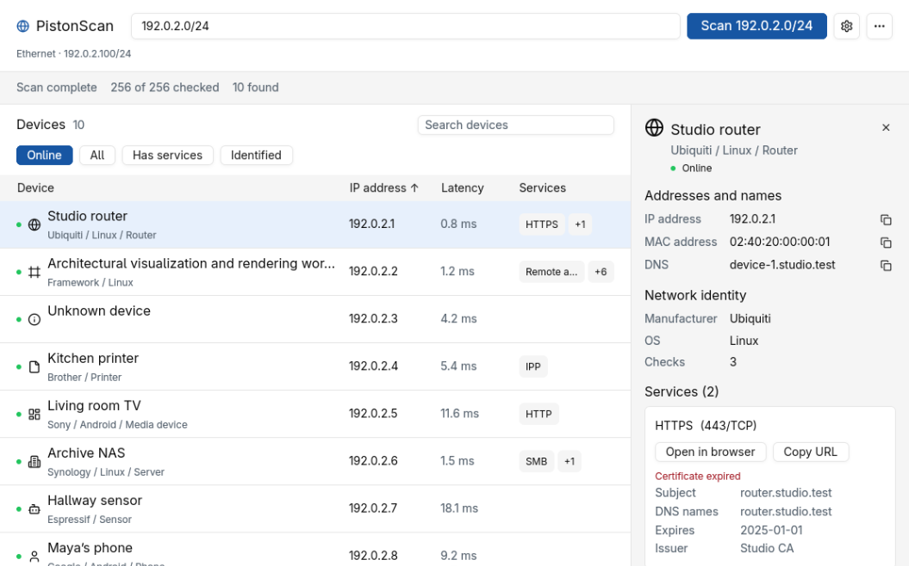

# PistonScan

PistonScan is a desktop IP scanner for finding devices on your network. It suggests the subnet for your active IPv4 interface. You can also enter one address or another subnet.



Select **Scan** to start. Devices appear as checks finish. Search by name, IP address, MAC address, vendor, or service. Select a device to inspect its addresses and open services.

PistonScan follows the system appearance. [See the dark interface](docs/screenshots/inspector-dark.png).

Open the three-dot menu to import or export a JSON snapshot. You can also pass a snapshot path to the executable. Open **Scan settings** to adjust the number of simultaneous checks, set a delay, or choose which checks to run. The device list stays visible while you edit these settings.

| Action | Windows and Linux | macOS |
| --- | --- | --- |
| Find a device | Ctrl+F | Cmd+F |
| Start or stop a scan | Ctrl+R or Ctrl+Enter | Cmd+R or Cmd+Enter |
| Export the scan | Ctrl+E | Cmd+E |
| Move through devices | Up or Down | Up or Down |
| Open device details | Enter or Space | Enter or Space |
| Clear search or close a panel | Esc | Esc |

PistonScan starts with ICMP echo. For hosts that respond, it checks DNS, mDNS, NetBIOS, LLMNR, SMB, the neighbor cache, and common TCP and UDP services. It can also read TLS certificates and AirPlay metadata. See [the protocol reference](PROTOCOLS.md) for details.

## Platform requirements

| Platform | Requirements |
| --- | --- |
| macOS | macOS 10.15.7 or later on Intel with Metal. macOS 11 or later on Apple silicon. Install Xcode with the Metal toolchain to build. |
| Windows | x64. Install the Visual Studio C++ build tools and a Windows SDK to build. |
| Linux | x64 with an X11 or Wayland session and a working Vulkan driver. |

The scanner uses the operating system's `ping` utility on all three platforms. It also uses `arp` when the local neighbor cache does not supply a MAC address. Run the application as a regular user with permission to send ICMP echo requests.

For Ubuntu 24.04, install these Linux build packages.

```sh
sudo apt-get install build-essential cmake clang libclang-dev pkg-config \
  libasound2-dev libfontconfig1-dev libfreetype6-dev libx11-dev libxcb1-dev \
  libxkbcommon-dev libxkbcommon-x11-dev libwayland-dev libvulkan-dev libssl-dev \
  iputils-ping net-tools
```

## Build and run

Install Rust with rustup. Cargo uses the version in [rust-toolchain.toml](rust-toolchain.toml).

```sh
cargo run --locked
cargo build --locked --release
```

The release executable is in `target/release`. The macOS CI job also assembles a universal `PistonScan.app` with Intel and Apple silicon binaries.

## Contributing and support

Read [the contribution guide](CONTRIBUTING.md) to set up the Git hooks and run checks. Use [the support guide](SUPPORT.md) for questions and issues.
